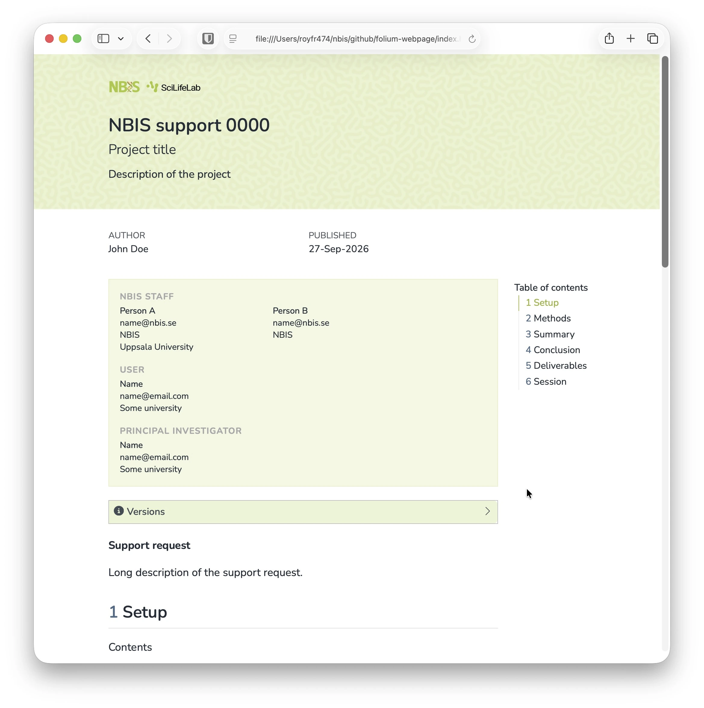

# folium-webpage <span><a href="https://github.com/royfrancis/folium-webpage"></a></span>

[](https://github.com/royfrancis/folium-webpage/actions?workflow=deploy)  [](https://github.com/royfrancis/folium-webpage/actions?workflow=linkcheck)  

This is a single page quarto html template for project reports. This is part of the Folium collection. For a multi-page website template, see [folium](https://github.com/royfrancis/folium). For Typst PDF template, see [typst-folium](https://github.com/royfrancis/quarto-typst-folium).



For a demo page, see [here](http://royfrancis.github.io/folium-webpage).

## Usage

- Required quarto 1.8.25 or higher
- To download a starter template, run in terminal:

  ```
  quarto use template royfrancis/folium-webpage
  ```

- Add optional extensions if needed

  ```
  quarto add quarto-ext/fontawesome
  quarto add mcanouil/quarto-collapse-output@1.4.0
  quarto add royfrancis/quarto-accordion
  ```

in which case, filters need to be declared in YAML front matter:

  ```
  filters:
    - collapse-output
    - fontawesome
  ```

- Launch preview in the browser

  ```
  quarto preview index.qmd
  ```

- Render

  ```
  quarto render index.qmd
  ```

## Tips

- Template directory structure

  ```
  .
  ├── assets
  ├── _extensions
  └── index.qmd
  ```

- Update `nbis` meta variables
- Use `##` as the highest level heading.
- The output html is intended to be standalone with no child assets. To disable this set:

  ```
  standalone: false
  embed-resources: false
  ```

## Acknowledgements

- Built using [Quarto](https://quarto.org/)
- Uses the [fontawesome extension](https://github.com/quarto-ext/fontawesome) to include fontawesome icons

---

2026 • Roy Francis
